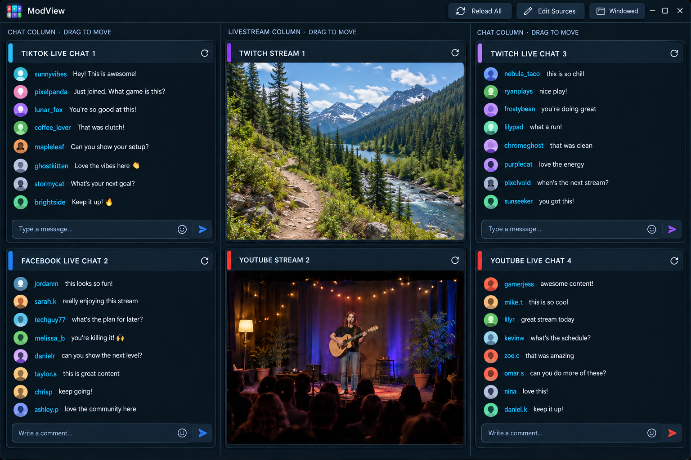

# StreamySpace

StreamySpace is a Windows app for moderating live streams. Put the streams and chats you care about side by side in one window: up to **4 livestreams** and **4 chats** from **Twitch, YouTube, TikTok, Facebook Live and Kick**. Combine several chats into one **Unified Chat** feed, let **Auto-Monitor** outline messages that may need a look, and use each platform's own moderation tools from the same window.

## Install

1. Download `StreamySpace-Setup-1.0.3.exe` from the latest [GitHub release](../../releases/latest) and run it. It installs just for you, adds a Start Menu shortcut and can add a desktop shortcut.
2. Windows may warn about an unknown publisher because the installer is not signed. Choose **More info**, then **Run anyway**.
3. The Microsoft Edge WebView2 Runtime is required. It is already on most Windows 10 and 11 PCs.

Updating is the same: run the newer installer over the old one. Your workspaces, sign-ins and settings are kept.

## Getting started

1. **Platform connections.** Sign in to the platforms you use. You can skip any of them. You can come back to this screen any time.
2. **Customize workspace.** Pick or create a workspace, add your livestreams and chats (paste a channel or video URL, or a username), choose a layout style, and press **Open moderation view**.
3. **Moderation view.** Your panes, laid out automatically. Use **Edit workspace** to change anything.

StreamySpace reopens your last workspace on launch.

| Platform | Livestream | Chat |
| --- | --- | --- |
| Twitch | ✅ | ✅ |
| YouTube | ✅ | ✅ |
| TikTok | ✅ | ✅ |
| Facebook Live | ✅ | ✅ |
| Kick | ✅ | ✅ |

## Workspaces and layout

- Keep as many workspaces as you like: **New, Duplicate, Rename, Delete, Export, Import**. Drag workspaces in the list to put them in your order.
- Layout styles: **Balanced, Chat focus, Stream focus**. StreamySpace re-arranges panes to fit your window as you resize it.
- In the moderation view, drag a pane's title to swap it with another pane, drag a column header to move a column, and drag the dividers to resize. Changes show a **CUSTOM** badge. **Save layout** keeps them, **Reapply layout** goes back to the saved arrangement.
- **Full screen** and **Reload all** are in the toolbar.

## Unified Chat

Combine two or more chats into one feed, in the order messages arrive.

- Turn it on with **Configure Unified Chat** on the workspace screen. You can have up to two groups.
- Each message shows its time, platform logo, the channel it came from and the user. Colours follow the platform.
- **Send to** lets you reply from the feed. Pick the platform (or the channel, when you have several) and type. The box border and placeholder show where your message will go, and nothing is ever sent to more than one platform. It uses your signed-in chat on that platform, so its own rules apply.
- Click a platform button above the feed to bring that platform's original chat to the front. The send box is greyed out while you do, so you can't send to the wrong place. Click **Unified** to return.
- The **⋯** on a message opens that platform's moderation options for it. Users you have timed out or banned from the feed are marked.

## Auto-Monitor

Auto-Monitor outlines chat messages that may deserve a closer look. It only highlights: it never bans, times out, hides or deletes anything.

- Outline colours: yellow (low), orange (medium), red (high), thick red (critical). Hover a message to see why it was flagged.
- Turn it on or off in the Moderation section of the workspace screen. It works on every chat pane and in Unified Chat.
- **Detection categories** let you switch each type on or off and set it to Low, Medium or High sensitivity: profanity, harassment, hate speech, threats, sexual harassment and spam. Spam covers flooding, repeated messages, all-caps, emote floods and suspicious links.
- **Auto-Monitor rules** lets you add your own words or phrases with a category and severity. They are added to the built-in rules, and you can test any message in the rules window.
- Everything runs on your PC. No AI services are used and no chat is sent anywhere.

## Moderation with your own account (optional)

Under **API accounts** you can connect your Twitch, Kick or YouTube account through each platform's official sign-in. Messages in Unified Chat then get a moderation menu to delete a message, time out, ban or unban a user. What you can do depends on your real permissions in that channel, and StreamySpace tells you when an action is not allowed. Disconnect at any time. Nothing is needed for viewing, chatting or Auto-Monitor.

## Good to know

- Chat panes are always muted, so a hidden video never plays sound.
- TikTok chat can hide follow, share, gift and Fan Club join messages, per pane.
- Facebook Live streams start muted when Facebook leaves them paused.
- StreamySpace checks that you are signed in for every platform you use. It cannot see whether you are a moderator, so confirm that on the platform.
- Platform websites change without notice. If a pane stops looking right, press **Reload all** or update StreamySpace.
- Your data stays on this PC in `%LOCALAPPDATA%\StreamySpace`: settings, workspaces, custom rules and one separate browser profile per platform for your sign-ins. Deleting that folder resets the app.
- Coming from ModView? Your workspaces, rules and sign-ins move over automatically on first launch.
